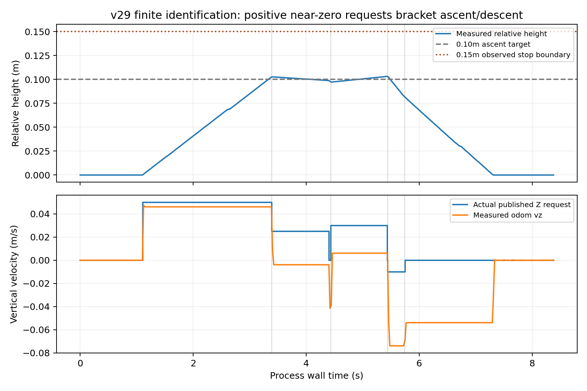

# v29 低高度有符号 Z 实测独立分析

本局 ID `d9abe4ad-d514-4e69-9f3c-c90cab5ba875`；测评编号 `#54747419`，runId `run_20261112_074858_f351d29c`。官方终态 `failed / score=null / 41.760s`，依据 `runs/evidence/20261112/trim_v29_list_settled_check.json`。只读恢复本队公开传感器和实发请求，没有读取裁判私有资料。

**固定辨识协议完整运行，已回到起始支撑高度附近并实测静稳。** `+.025` 引起缓慢下降，`+.030` 引起缓慢上升，`-.010` 引起明显下降；因此已有近零正请求的升降区间证据。尚未实际运行高度保持控制器，不能把辨识完成称为悬停成功或完整巡检成功。

## 证据完整性

原始 `runs/evidence/20261112/callback_trim_v29.jsonl` 为167222字节，9事件，SHA256 `406456d8614d07be58ac3e07af749b4cd15640fb222d6e10fbf0ce540e89864c`。会话 `ecf06e3d5bec4462a40a485a9a81e915` 的4片完整、无重复、元数据一致。gzip 120325字节、SHA `ee744aa3cd18d5e22026c59c52a0acd54f8d431243bdb9ebb74e5942fcdef588`；原JSON 1102130字节、SHA `cef9646d663cf00752fc2096a6085edbc8f2eeabbe85d740df09b4d4a770c9ba`。长度、双SHA和core所有共有字段逐键一致。

411条odom、174条实际命令、65帧水平scan、164帧下视scan、821份TF均已保留，容量drop全部为0。完整恢复JSON、gzip、CSV和校验位于 `runs/analysis/20261112_trim_v29/`；`evidence.json` 保留原字节和完整payload。网络回传标记仍是 `unverified_callback`，哈希验证提供文件内部一致性，不是独立来源签名认证。

## 固定输入和真实响应

去除初始响应、阶段零间隙后的显式内部观察窗（正段首请求后 `.15s`，负段 `.06s`，各段末请求前 `.025s`）得到：

| 实际请求 m/s | 内部样本数 | odom vz 中位 m/s | 真实方向 |
| ---: | ---: | ---: | --- |
| +.050 | 100 | +.046100 | 上升 |
| +.025 | 40 | −.003900 | 缓慢下降 |
| +.030 | 38 | +.006100 | 缓慢上升 |
| −.010 | 8 | −.073900 | 下降 |

同窗源stamp高度差分与twist速度一致；arrival墙钟差分另外输出，包含传输抖动，不能当作精确执行延迟。零返回阶段仍观测到约 `−.0539m/s` 的回落，证实全零不能保持高度。阶段结束的短暂零请求也造成向下瞬态，不能当作正trim的稳定响应。

本局这些工作点只支持在当前初始姿态、低高度和本次平台环境中的局部判断。`.025–.030` 已把低速升降方向夹住，可用于设计新的有限高度保持实验；区间内部任何具体保持值仍需闭环实测，不能从几个点外推全域线性、不同姿态或插件内部机制。

## 预算、归零和返回

- 原点建立于墙钟 `1.110724203s`，初始 z `0.055000708m`；最大相对升高 `0.103096694m`，没有接近 `.15m` 硬升界。
- 累计三维路径独立逐帧复算为 `0.21730158066952623m`，与控制器记录一致；最大横漂 `0.000183527m`。
- 正trim各有20次实际成功非零请求；负trim6次。所有非零请求都在各自phase期限前发出，未发现原发布边界反例。负阶段最后非零请求 `5.698153362s`，期限 `5.745911629s`；零返回首次请求 `5.748690211s`。这些是进程观察和发送返回时刻，不是底层执行器时刻。
- 首次运动到本地正常结束 `7.259151136s`，未超过永久10s预算；没有预算之后的非零，亦没有已知相对高度≤`.035m`的trim非零。
- 回到支撑高度后，连续51帧满足高度±`.005m`、速度≤`.005m/s`、角速度≤`.01rad/s`；该帧块源时间跨度1.0s、到达墙钟跨度1.016222s，位置半径`.000177410m`。最后一秒观察窗最大高度误差约`7.67μm`。这是odom支撑高度附近静稳，非独立触地传感器或受控降落证明。
- 最大请求间隔`.087089s`，最大odom源间隔`.02s`、到达间隔`.052312s`，没有长时间停止刷新指令的证据。

本地终态 `FINISHED / support_return_verified_trim_complete`，`protocol_complete=true`、`support_return_verified=true`，launcher exit0。`official_score=null`、`full_mission_complete=false` 保留原值。本局没有发送识别、到点、灯光或全任务完成消息，因此应按独立辨识局解读；官方 failed/未提取成绩与本地有限辨识协议完成分别记录。无官方成绩不代表源码未启动，也不能把本地正常结束改写为官方巡检计分通过。

## 下一步边界

可在同一低高度柱、相同净空/源龄/姿态/总路径界下，新增有界P/PD高度保持与受控下降实验。仅把本次局部升降区间作为候选前馈范围，用实际z、vz反馈验证连续高度误差；先不增积分或直接接穿窗。保留反馈失效时独立归零和可能回落的解释。完整飞行FOV、横向飞行、窗框净空、照射和完整成绩仍需后续独立证据。

