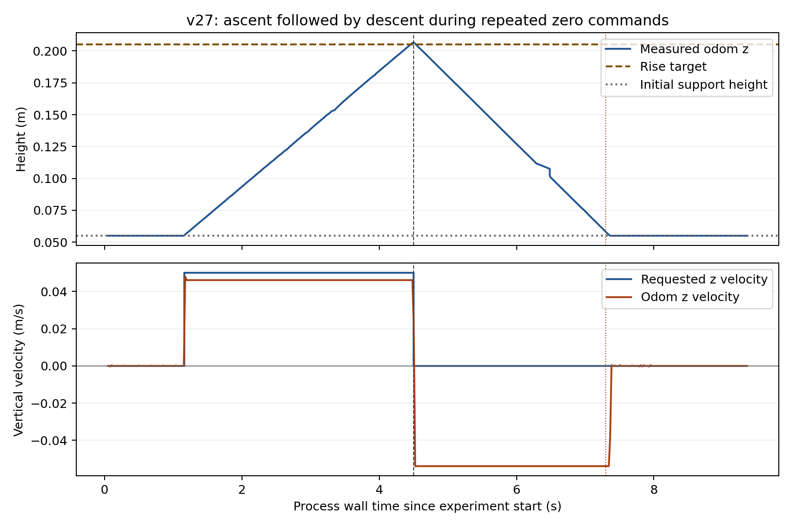

# v27 有限起飞响应独立分析

2026-11-12；平台练习 ID `997eb6e5-bdda-4abc-88c2-ecb252319b4a`。本轮只读分析，不修改控制源码、不上传、不读取裁判私有信息。

**本局证实在初始水平姿态下，持续 `linear.z=+0.05` 能产生约 0.152m 的真实上升；持续全零不能保持高度。** 上升结束后的回落基本完整解释了 `total_path_limit`。这不是起飞接口未响应，也不是正式任务得分：恢复数据的 `official_score=null`、`full_mission_complete=false`。

## 数据完整性

原文件 `runs/evidence/20261112/callback_vertical_v27.jsonl`：195407 字节，SHA256 `967b429a02c4bb675c32d4ef384091d774bb519ed20fe5c63c81a08bf9c05099`，共 9 事件。会话 `dd830b26c28043e195bee21de05e1642` 的 4 片顺序为 0–3，分片元数据完全一致，base64 严格解码成功。

| 校验对象 | 字节数 | SHA256 |
| --- | ---: | --- |
| gzip 压缩数据 | 141742 | `e1ecfa981de2de10972b044c8de312013b2955466e4f8a2925e3fc40a1091fae` |
| 完整原始 JSON | 1165751 | `1b1c20afeeff67b39763f0a55120725ecccace868f4cb9c95be905447df4b93c` |

长度及双 SHA 与每片声明一致，恢复 JSON 与小 core 共有字段全部一致。恢复了 453 条里程计、191 条命令、73 帧水平 scan、184 帧下视 scan、749 份 TF；各容量 dropped 均为 0。该校验确认本地回传文件内部完整与一致，不能单独为标为 `unverified_callback` 的网络来源建立独立签名认证；平台 ID 来自主控本局记录。

完整恢复文件、gzip、校验记录、数值分析及 CSV 存于 `runs/analysis/20261112_vertical_v27/`。`evidence.json` 保留原字节，没有重新格式化或改变浮点数。

## 命令与真实响应

下表时间为控制进程启动后的墙钟秒；odom 的仿真源 stamp 另外保存。命令没有同源的执行器应用时间戳，所以不能把两条消息的 arrival 差当作精确执行延迟。

| 事件 | 墙钟时间 s | 观测或输出 |
| --- | ---: | --- |
| 原点建立、开始上升 | 1.162023 | z=`0.055000195m` |
| 首次正 Z 发布 | 1.162175 | `+0.05m/s` |
| 上升平台期 | 约 1.46–4.40 | odom vz 中位 `+0.046100m/s` |
| 最后正 Z 发布 | 4.451249 | `+0.05m/s` |
| 首次改发全零、进入 OBSERVE | 4.501608 | 此后所有 UAV 命令均为零 |
| 最高观测点 | 4.503480 | z=`0.206669196m`；实升 `0.151669001m` |
| 第一帧明确负 vz | 4.524935 | vz=`-0.053900m/s` |
| 累计路径首次达到 0.30m | 7.302627 | z=`0.057905196m`；路径 `0.300433005m` |
| 命令记录首次标为 STOP | 7.321538 | 零输出，原因 `total_path_limit` |
| 返回原高度上方 1mm 内 | 7.343976 | z=`0.055749196m`；距首零 2.842368s |
| 命令记录首次标为 FINISHED | 9.340460 | STOP 后两秒的清理结束 |
| 最后一帧 | 9.353613 | z=`0.055000708m`，已回到支撑高度附近 |

命令共 66 次正 Z、125 次零，地面 191 次均为零，错误列表为空。最长命令间隔 `0.065113336s`，远短于候选 world 的 `cmd_timeout=0.5s`。因此本局零命令期间的回落不能解释为本队停止刷新命令造成的 0.5s 超时。没有负 Z 命令，也没有人为请求下降。

改发零后的 `.1–2.0s` 区间，odom vz 几乎恒为 `-0.053900m/s`。约首零后 1.0163s 的 z 为 `0.152769196m`，2.0112s 为 `0.099947196m`，3.0041s 为 `0.055000251m`。最高反馈速度 `0.053900m/s`，最高倾角 `3.805e-7rad`，相对原点最大横漂 `0.000058400m`。这次是近水平、近原位的垂直响应证据，尚不能确认任意姿态的 body/world Z 或横向控制合同。

odom 最大源 stamp 间隔 `0.10s`，最大到达间隔 `0.196687s`。完整 CSV 同时保留到达时间与仿真 stamp；曲线局部 arrival 抖动不应解释成真实高度瞬跳。

## 累计路程触发原因

从真实原点对应的 odom 开始逐帧独立累加三维欧氏距离，得到 `0.3034919938538383m`，与 core／恢复 JSON 的 `total_path_m` 一致到 `1e-12m`。分解为：

| 路段 | 三维累计路程 m |
| --- | ---: |
| 原点到峰值 | 0.1516690053 |
| 峰值到末帧 | 0.1518229886 |
| 合计 | 0.3034919939 |

垂直绝对位移之和为 `0.3034212370m`，其余仅约 `0.000070757m`。回落大约又消耗了一次完整的上升路程，因此在接近支撑面时越过 0.30m 硬界。不是横漂占用了 0.15m，也不是哈希恢复错误。把路径上限调大只能延后本次结束，不能得到高度保持。

`FINISHED` 是源码 STOP 后两秒的本地清理状态，`reason=total_path_limit` 保留首次停机原因；不是五秒 OBSERVE 正常完成，更不是官方结算标志。程序 exit 0 同样只证明清理路径正常返回。

## 与公开环境资料的对照

固定来源 `ranmengjia/ICAN@82b041043849a5d86e085390bf0df787366d98cd`，属于公开第三方历史副本；当前平台是否完全使用该插件版本尚未确认。

- `external_resources/ranmengjia_ICAN/binary_install/share/ican_inspection_sim/worlds/inspection_task1.world:431` 配置 `libican_gazebo_uav_simple_move.so`，`update_rate=100`、`publish_rate=50`、`cmd_timeout=0.5`、`idle_passthrough=true`、`min_z=0.03`、`max_z=1.8`。这是配置文本，不是可据以断言内部控制逻辑的源码。
- `external_resources/ranmengjia_ICAN/docs/仿真环境与接口说明.md:45` 将最小例程描述为正 Z 上升、正 X 前进、全零悬停、负 Z 下降，并建议订阅 `/uav/odom` 实现 PID/MPC。**“全零悬停”这句与本次当前平台真实观测不符，后续实现应以本局反馈为依据。**
- 当前已存课程元数据 `runs/evidence/20261111/inspection_course.json` 仅有环境配置视频记录，`transcript=null`，没有可用的插件源码或可核对的逐字飞控实现。不能把它当作已经证明零速保持的课程证据。
- 只读检索固定公开仓库树未找到 `uav_simple_move` 源码；未下载或执行任何插件二进制。随后按主控指示停止网络检索。另已取得的 `minimal_user_node.py` 实际含第三方任务扩展，未执行、不分析其任务逻辑、不将其当官方飞控实现。

`idle_passthrough=true` 使“全零可能进入空闲／释放控制、重力或另一运动插件接管”成为合理待检假设；当前没有该公开插件源码，不能断言具体分支。正命令 `0.05→vz约0.0461` 与全零 `0→vz约-0.0539` 两个观测点也不足以拟合近零响应、重力前馈、死区、制动或下降规律。

## 后续最小高度保持设计建议

先保留 v27 为冻结的响应证据，新增独立实验，不直接改完整比赛任务。下一局应验证“有界高度保持＋受控回到支撑面”，仍不发送识别、到点、灯光、穿窗或完成声明。

1. **缩短高度与路径需求。** 候选目标相对升高 `0.10m`，硬上升界仍不超过原 `0.20m`，横漂、姿态、数据新鲜度和 DDS 门保持。原地升降名义路程约 0.20m，可在原 0.30m 总路径预算内留下闭环与落地余量；不要通过放宽路程门掩盖回落。
2. **先辨识近零非零响应。** 在同一有限柱内用很短、受高度与路程界限约束的微小正／负 Z 探测，记录实际 vz 和模式切换。具体最小幅度仍需实测，不能把 `1e-6`、`0.0039` 或任何猜测当作已证实的“激活／悬停命令”。本局只有正 `0.05` 和全零两个输入，不能据此批准负 Z 或任意幅度。
3. **保持阶段用当前反馈闭环。** 以真实 `/uav/odom` 的 z、vz 为反馈，候选为限幅的 P/PD 高度控制，限制输出斜率，先不加积分；若辨识得到稳定的非零保持偏置，再作为有界前馈加入。达到目标后持续闭环并验证连续时段的高度误差、vz、漂移，不以单帧到高或 `cmd=0` 宣称悬停。
4. **零附近的工作模式必须单独处理。** 不能直接把死区输出全部替换成同一个正数，否则会产生单向爬升；也不能未经辨识就交替正负微脉冲。若全零确实释放控制，需要依据已测模式选择有证据的近零保持策略，或者停留在“保持能力未通过”，不能通过横向／yaw 抖动伪装非零激活。
5. **下降阶段是新合同。** 只有负 Z 小探测的实际方向、速度与回零后行为被确认后，才做有界下降。下降目标相对起始支撑高度，不是 world 中的 `min_z=0.03`；后者并非本机体实际接地原点。接近支撑面逐步减速，以高度＋实际 vz＋静稳驻留验证落地，不将全零后的非受控回落称为受控降落。
6. **故障归零仍保留，但说明其物理含义。** 数据失效、硬界或发布异常仍必须停止主动运动并独立尝试零输出；本局已证明零不能当空中刹停／悬停。不能在反馈失效时持续最后一个正偏置“保高”。试验高度和净空应为可能回落留出空间，异常后继续记录轨迹与支撑恢复，不能记录零发送就宣称状态已安全静止。

本局可解除“正 Z 接口未产生真实上升”的阻塞；下一项必要证据是**低高度、连续保持的误差与速度记录，以及负 Z 小探测／受控下降**。穿窗、0.8m 照射、完整飞行与正式成绩仍没有被本局证明。
